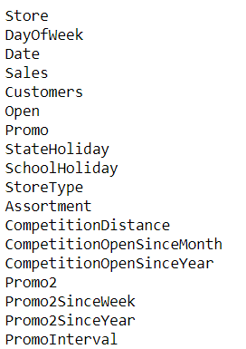
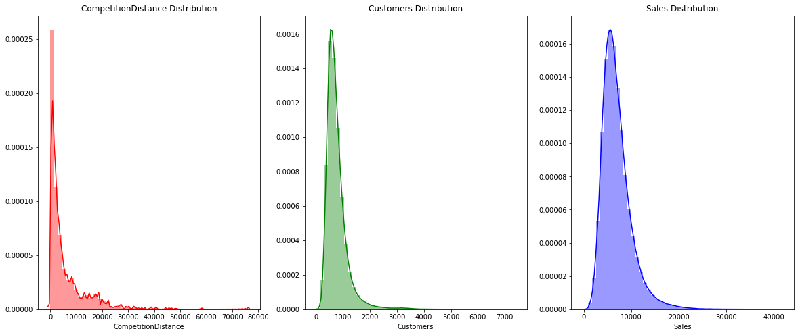
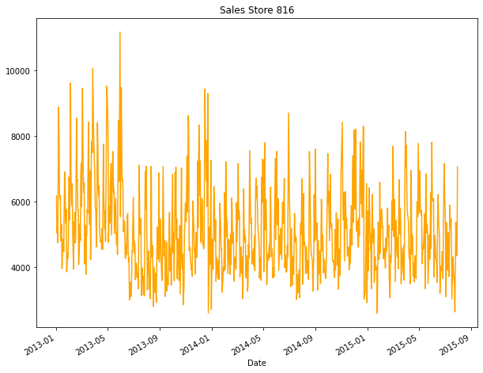
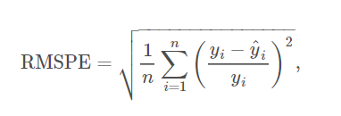
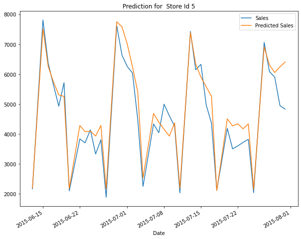
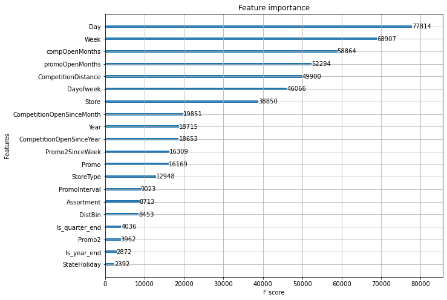
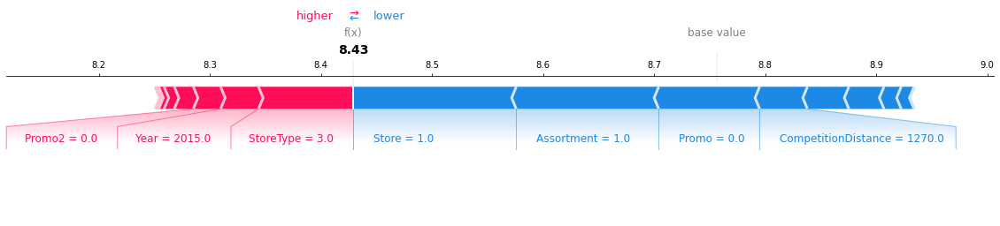
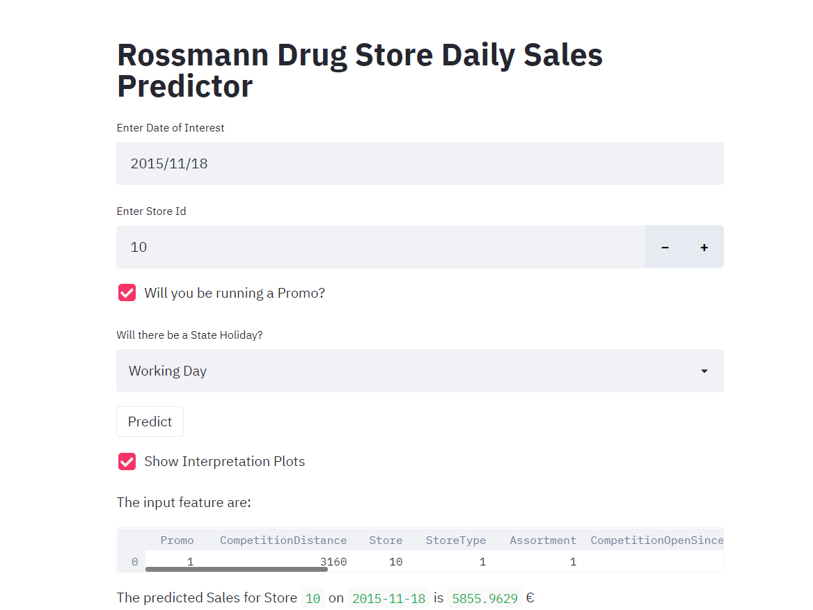

# Rossmann Store Sales Forecasting

End-to-end daily retail sales forecasting pipeline and interactive Streamlit application for the **Rossmann drug store chain**, built on the [Kaggle Rossmann Store Sales](https://www.kaggle.com/c/rossmann-store-sales/data) dataset across **1,115 stores**.

The project covers exploratory data analysis, temporal validation design, feature engineering, model benchmarking across **Random Forest**, **XGBoost**, and a **fastai Tabular Neural Network with Entity Embeddings**, SHAP-based local explainability, and a Streamlit dashboard for on-demand store sales forecasting.

---

## Key Highlights

- **Time-Aware Validation**: Holds out the final 6 weeks (42 days) per store to mirror the 6-week Kaggle forecast horizon.
- **Domain Feature Engineering**: Derives calendar attributes (`Dayofweek`, `Week`, `Day`, `Year`, `Is_quarter_end`, `Is_year_end`), competitor tenure (`compOpenMonths`), distance buckets (`DistBin`), and promotion duration/interval indicators (`promoOpenMonths`, `MonthInPromoInt`).
- **Model Comparison & Selection**: Evaluates Random Forest, XGBoost, and a Tabular Neural Network with Entity Embeddings on log-transformed daily sales; ships the full-data XGBoost model (`Model/xgb-full.pkl`) for low-latency inference and tree-based SHAP explanations.
- **Interactive Web App**: Streamlit interface (`app.py` + `forecast_utils.py`) accepting date, store ID, promo flag, and state holiday type, returning predicted sales in EUR (`€`) along with SHAP force plots and gain-based feature importance.

---

## Repository Structure

```text
Store-Sales-Forcasting-/
├── app.py                        # Streamlit web UI for daily store sales forecasting
├── forecast_utils.py             # Feature engineering, inference, and SHAP/importance plots
├── 01_eda_store_sales.ipynb      # Exploratory analysis, cleaning, and feature generation
├── 02_model_training.ipynb       # Training & tuning RF, XGBoost, and Tabular NN models
├── Model Analysis.ipynb          # Validation evaluation, forecast plots, and SHAP analysis
├── Data/
│   └── store.csv                 # Static metadata for all 1,115 Rossmann stores
├── Model/
│   ├── feature-xgb.pkl           # Ordered list of 20 input features expected by XGBoost
│   ├── xgb-val.pkl               # Validation-split XGBoost model
│   └── xgb-full.pkl              # Full-dataset XGBoost model used by the web app
├── figs/                         # Saved EDA, evaluation, SHAP, and UI figures
├── requirements.txt              # Python dependencies
└── README.md
```

---

## Dataset & Preprocessing

The modeling dataset merges the Kaggle `train.csv` and `test.csv` daily records with `Data/store.csv` store metadata (1,115 stores, 10 attributes):



### Preprocessing & Feature Pipeline

1. **Open-Store Filtering**: Training filters out closed days and zero-sales records (`Sales != 0`), and drops `Customers` (unavailable at prediction time) and `Open`.
2. **Missing Value Handling**: Missing store metadata fields (`CompetitionDistance`, `CompetitionOpenSinceMonth`, `CompetitionOpenSinceYear`, `Promo2SinceWeek`, `Promo2SinceYear`, `PromoInterval`) are zero-imputed (`fillna(0)`).
3. **Target Transformation**: Daily `Sales` is right-skewed and modeled in log space (`LogSales = np.log(Sales)`), then exponentiated (`np.exp`) back to EUR at inference time.
4. **Engineered Features** (`get_features` in `forecast_utils.py`):
   - Calendar components via `fastai.tabular.all.add_datepart` (`Year`, `Week`, `Day`, `Dayofweek`, `Is_quarter_end`, `Is_year_end`)
   - `MonthInPromoInt`: Binary indicator for whether the target month appears in `PromoInterval`
   - `compOpenMonths`: Months elapsed since the nearest competitor opened (bounded to `(0, 1000)`)
   - `promoOpenMonths`: Months elapsed since `Promo2` began (bounded to `(0, 1000)`)
   - `DistBin`: Competition distance tier (`0`: missing, `1`: `<= 3000m`, `2`: `<= 9000m`, `3`: `> 9000m`)
   - Ordinal encoding of `StateHoliday`, `StoreType`, and `Assortment`, plus categorical coding for `PromoInterval`

---

## Exploratory Data Analysis

Key patterns discovered in `01_eda_store_sales.ipynb`:

- **Sales Skew & Log Scaling**: Raw daily sales and customer counts are right-skewed; applying a natural logarithm yields an approximately symmetric target distribution.
- **Calendar & Store Effects**: Average daily sales peak on Mondays and Sundays (with high variance on Sundays when few stores remain open), and dip near the start/end of the calendar year.
- **Holidays & Store Types**: Stores are largely closed on state holidays, though those open on holidays exhibit higher median sales; `StoreType` `b` achieves higher average sales with greater dispersion.




---

## Validation & Modeling Results

### Metric

Models are evaluated using **Root Mean Squared Percentage Error (RMSPE)**:



### Cross-Validation Scheme

For every store in `trainval.csv`, the most recent **42 days (6 weeks)** are held out as the validation set (`create_time_splits`), ensuring all 1,115 stores are represented in both training and validation splits.

### Benchmark Comparison

Three model families were trained in `02_model_training.ipynb` and evaluated in `Model Analysis.ipynb`:

| Model | Validation RMSPE | Validation MAPE | Notes |
| --- | :---: | :---: | --- |
| **Random Forest** | `0.1370` | `0.0180` | Baseline (`300` trees) + OOB feature pruning (`0.12177` Kaggle test RMSPE noted) |
| **XGBoost** | `0.1284` | `0.0226` | Tuned `gbtree` (`800` estimators, `max_depth=10`, `lr=0.06`, `subsample=0.5`, `reg_lambda=0.02`); `0.11213` Kaggle test RMSPE |
| **Neural Network (Entity Embeddings)** | `0.1158` | `0.0045` | fastai `tabular_learner` (`[600, 300]` layers, `embed_p=0.2`, `wd=0.03`); `0.112` Kaggle test RMSPE noted |

> **Deployment Choice**: **XGBoost** (`Model/xgb-full.pkl`) is used in the Streamlit app for fast CPU inference, lightweight deployment without PyTorch runtime overhead, and native `TreeExplainer` SHAP support.



---

## Model Explainability

The application and `Model Analysis.ipynb` provide two complementary interpretability views for the XGBoost model:

1. **Global Feature Importance (Gain)**: Identifies the highest-impact predictors (`Promo`, `CompetitionDistance`, `Store`, `StoreType`, `Assortment`, and temporal/competition features).
2. **Local SHAP Force Plot**: Breaks down how each input feature pushes a specific day's predicted sales up or down from the model baseline.




---

## Getting Started

### Prerequisites

Install the dependencies listed in `requirements.txt` (note: the pre-built PyTorch wheel URLs in `requirements.txt` target Python 3.6 on Linux; on Windows or newer Python versions, install `torch`, `fastai`, `xgboost`, `shap`, `streamlit`, `pandas`, `numpy`, `scikit-learn`, and `matplotlib` via your package manager):

```bash
pip install -r requirements.txt
```

### Run the Streamlit App

From the repository root:

```bash
streamlit run app.py
```

In the web interface:
1. Choose a **Forecast Date** (starting `2015-08-01` onward).
2. Enter a **Store ID** (`1` to `1115`).
3. Toggle whether a **Promotion** is active and select any **State Holiday** (`Working Day`, `Public holiday`, `Easter holiday`, `Christmas`).
4. Click **Forecast Sales** (and optionally enable **Show Model Interpretability Plots** to display the SHAP force plot and XGBoost gain importance chart).



---

## Tech Stack

- **Data & Visualization**: Python, Pandas, NumPy, Matplotlib, Seaborn, SciPy
- **Modeling & Explainability**: Scikit-learn, XGBoost, fastai, PyTorch, SHAP
- **Web Interface**: Streamlit
